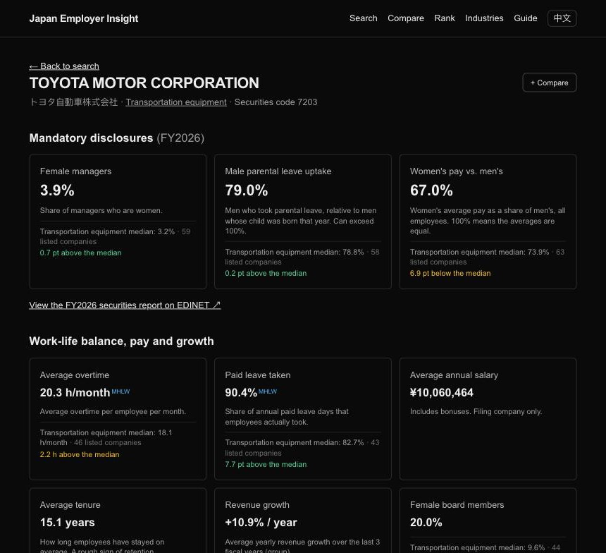
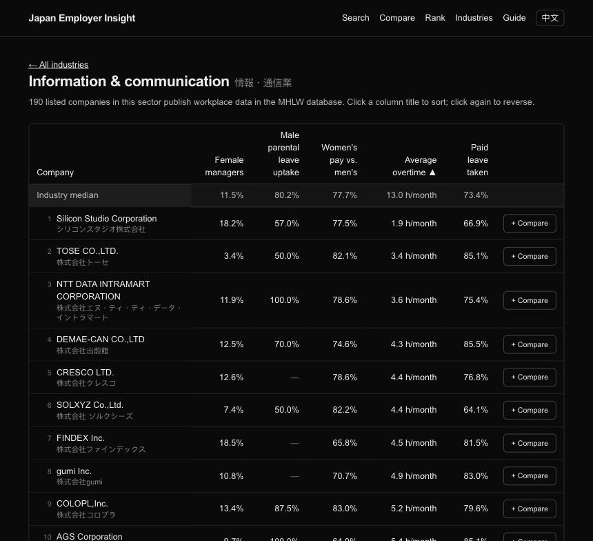
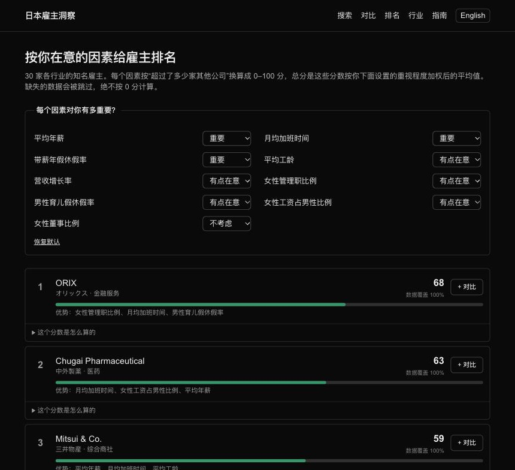

# Japan Employer Insight

[](https://github.com/yuqingtao1103/japan-employer-insight/actions/workflows/ci.yml)
[](https://japan-employer-insight.vercel.app)


**Compare Japanese employers on the workplace data they are legally required to disclose, in English and Simplified Chinese.**

[Open the site](https://japan-employer-insight.vercel.app) · [中文版](https://japan-employer-insight.vercel.app/zh) · [Guide to the data](https://japan-employer-insight.vercel.app/en/guide) · [Report a data error](https://github.com/yuqingtao1103/japan-employer-insight/issues/new?template=data-error.yml)



## Why

Since fiscal years ending on or after 31 March 2023, listed companies in Japan must report three workplace figures in their annual securities reports (有価証券報告書): the share of female managers, male parental leave uptake, and the gender pay gap. Many also publish overtime, paid leave and certifications in a government database.

This data is public, but it is in Japanese and spread across long filings. International job seekers, who often care most about these questions, have no easy way to compare employers. This site puts the figures side by side, explains what they mean, and links every number back to its source.

## Features

| Feature | What it does |
|---|---|
| 🔎 **Search** | Any of the ~3,800 listed companies by Japanese, English or kana name, or by securities code |
| 🏢 **Company pages** | Mandatory disclosures plus overtime, paid leave, salary, tenure and growth, each compared with the **industry median** |
| ⚖️ **Compare** | Up to 4 companies side by side, with the best and weakest value marked; shareable as a link |
| 📊 **Rank** | 30 well-known employers ranked by the factors you choose, with a breakdown of every score |
| 🗂️ **Browse by industry** | ~1,900 companies with published data across 33 sectors, sortable by any figure |
| 📖 **Guide** | Plain-language explanations of 総合職 / 一般職, えるぼし / くるみん, why parental leave can exceed 100%, and more |
| 🔗 **Traceable** | Every figure shows its fiscal year and source; tags mark values filled from other sources or checked by hand |

<table>
  <tr>
    <td></td>
    <td></td>
  </tr>
  <tr>
    <td align="center"><sub>Browse a sector, sorted by overtime</sub></td>
    <td align="center"><sub>Personal ranking (Chinese interface)</sub></td>
  </tr>
</table>

## How the data is put together

| Source | What it provides | How it is used |
|---|---|---|
| Securities reports via [EDINET DB](https://edinetdb.jp) | Mandatory disclosures, salary, tenure, revenue, filing links | Fetched per company through the API and cached |
| MHLW women's advancement database (open data) | Overtime, paid leave, parental leave, certifications, flexible work | Processed into `data/mhlw-workplace.json` |
| EDINET code list (FSA) | Names in Japanese, English and kana, sectors, corporate numbers | Processed into `data/listed-companies.json` for local search |

Each figure is taken from the first source that has a plausible value:

1. **Securities report** (default)
2. **Checked by hand** from the same report, when the automated data was missing or wrong (`lib/corrections.ts`, each entry cites the filing)
3. **MHLW database**, tagged on the page
4. A value outside the plausible range is shown with ⚠ and left out of comparisons
5. Otherwise **No data**, which is never counted as zero

The full notes, including terms of use, coverage and a company-by-company gap audit, are in [docs/data-source-notes.md](docs/data-source-notes.md).

## Tech stack

- [Next.js 16](https://nextjs.org) (App Router, Cache Components), React 19, TypeScript
- Tailwind CSS 4
- Vitest and GitHub Actions for tests and checks
- Hosted on Vercel, with Vercel Cron for a weekly cache warm-up; commits that only change docs, tests or GitHub settings skip the deploy (`ignoreCommand` in `vercel.json`) so the cache is kept

## Getting started

Requires Node.js 22.

```bash
npm install
cp .env.example .env.local   # then set EDINET_DB_API_KEY (free key from https://edinetdb.jp/developers)
npm run dev                  # http://localhost:3000
```

Never commit `.env.local`. During development, API responses are also saved in the git-ignored `.cache/` folder so that code changes do not use up the daily API limit.

| Command | What it does |
|---|---|
| `npm test` | Unit tests for search, data merging, ranking, industry medians and more |
| `npm run typecheck` | TypeScript check |
| `npm run lint` | ESLint |
| `npm run build` | Production build |

GitHub Actions runs all of these on every push to `main` and on pull requests.

### Project structure

```
app/[lang]/          Pages for each language (/en, /zh): home, company, compare, rank, industries, guide
app/api/warm/        Weekly cache warm-up called by Vercel Cron
lib/edinetdb.ts      EDINET DB client with caching
lib/metrics.ts       Metric definitions and the rules for combining sources
lib/ranking.ts       Ranking score calculation
lib/benchmarks.ts    Industry medians
lib/i18n/            English and Chinese text
data/                Processed MHLW data and the listed company list
scripts/             Scripts that rebuild the files in data/
tests/               Unit tests
docs/                Data source notes and screenshots
```

## Deployment

The site runs on [Vercel](https://vercel.com) (Hobby plan). Every push to `main` deploys automatically.

1. Import the repository in Vercel (framework preset: Next.js).
2. Add `EDINET_DB_API_KEY` as a Secret environment variable for Production.
3. Deploy.

Company figures from EDINET DB are cached for a week with `use cache: remote`, shared across server instances, so page views within a deployment use no API requests. A failed response, such as the daily limit, is cached for one minute only, and pages show a message instead of failing.

## Automatic updates

- **Company list**: a GitHub Action downloads the EDINET code list on the 2nd of each month, runs the tests and commits the new list if it changed.
- **Ranking data**: Vercel Cron calls `/api/warm` every Monday at 01:00 UTC to load the 30 ranking companies into the cache.
- **MHLW data**: the download page blocks scripts, so it is refreshed by hand every few months (steps in [docs/data-source-notes.md](docs/data-source-notes.md), section 4).

## Search engines and link previews

`app/sitemap.ts` and `app/robots.ts` describe the site for search engines, every page declares its English and Chinese versions, and shared links show a preview image with the company name and its three mandatory figures.

## Known limitations

- Diversity figures in EDINET DB cover the last 3 fiscal years; the first mandatory year (FY2023) is missing.
- Overtime and paid leave are published voluntarily, so many companies have no data.
- The API cache starts empty after each deployment, so the first page views after a deploy use API requests again (up to about 60 for the ranking page). The free EDINET DB plan allows 100 requests per day.

## Reporting a data error

Spot a wrong or missing figure? Use the link at the bottom of any company or industry page, or [open the form directly](https://github.com/yuqingtao1103/japan-employer-insight/issues/new?template=data-error.yml). Reports are labeled `data error`; confirmed fixes are added to `lib/corrections.ts` with the filing's document ID.

## Data sources and attribution

- Powered by [EDINET DB](https://edinetdb.jp). Source data: annual securities reports filed on the FSA's EDINET system.
- 女性の活躍推進企業データベースオープンデータ（2026年10月13日時点）（https://positive-ryouritsu.mhlw.go.jp/positivedb/opendata/）を加工して作成
- EDINET閲覧（提出）サイト EDINETコードリスト（https://disclosure2.edinet-fsa.go.jp/）をもとに作成 (PDL1.0)

## Disclaimer

Figures are extracted automatically and may contain errors. Check the original filing before relying on any number. This site is not investment advice.
